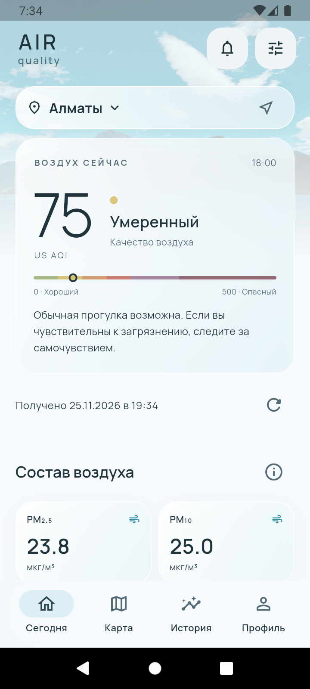
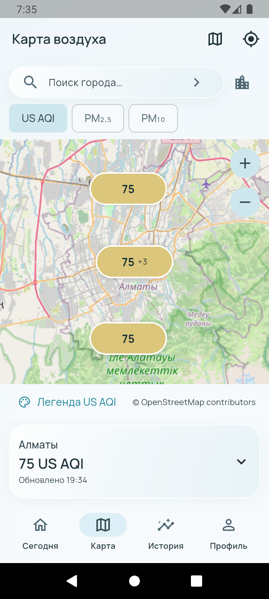
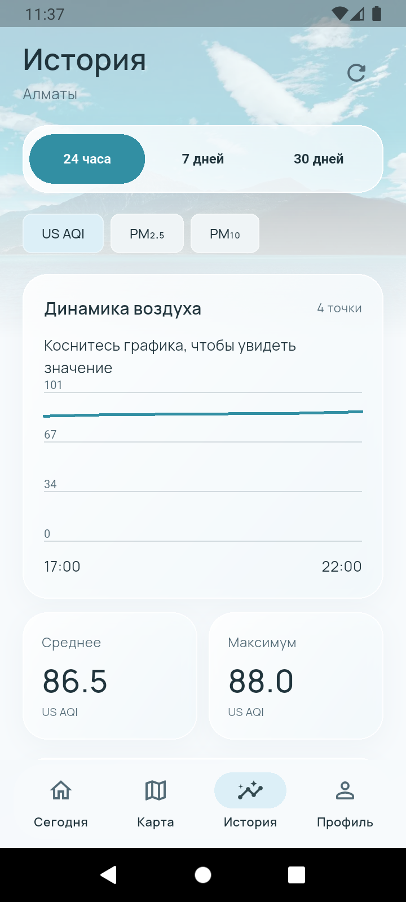
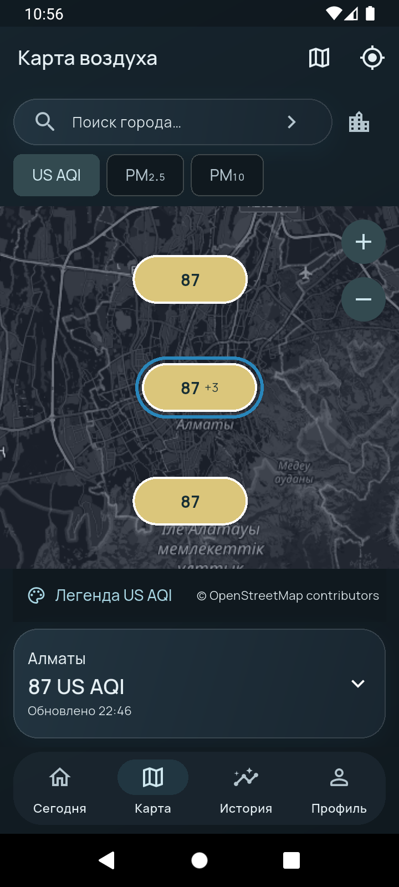

# Air Quality Monitor

Flutter-приложение для Android, которое помогает следить за качеством воздуха в городе. Показывает текущий US AQI, состав воздуха, прогноз и историю сохранённых оценок на основе данных Open-Meteo.

## Цель и аудитория

Цель проекта — сделать данные о воздухе понятными и помочь выбирать время для прогулок и активности. Приложение рассчитано на жителей городов, студентов, родителей и людей, которые занимаются спортом на открытом воздухе.

При разработке я ориентировалась на IQAir AirVisual, Windy и Plume Labs: понятная оценка AQI, наглядное представление данных и рекомендации для повседневных решений.

## Основные возможности

- Поиск городов, выбор места по геолокации, избранное и недавние места.
- Текущий AQI и концентрации PM₂.₅, PM₁₀, NO₂, O₃, CO и SO₂ при наличии данных.
- Почасовой прогноз на ближайшие 24 часа и рекомендации по активности.
- Сравнение качества воздуха в двух городах.
- История сохранённых оценок с графиком, календарём и фильтрами.
- Настройки единиц измерения, светлая, тёмная и системная темы.
- Заметки с фотографиями, локальные предупреждения и история уведомлений.
- Вход по email и через Google, синхронизация профиля и избранного через Firebase.
- Удаление аккаунта из приложения с подтверждением и повторным входом; локальная история и заметки сохраняются для гостевого режима.

Карта использует OpenStreetMap: показывает выбранные города и модельные оценки воздуха вокруг выбранной точки. Доступны геолокация, просмотр сохранённых данных, легенда цветов и раскрываемая карточка. Близкие маркеры объединяются с возможностью выбрать отдельную точку. Автоматические ежедневные push-сводки пока не реализованы.

## Технологии

| Задача | Инструменты |
| --- | --- |
| Интерфейс | Flutter, Dart, Material 3 |
| Состояние | Provider, flutter_bloc |
| Навигация | GoRouter |
| API и JSON | http, json_serializable, build_runner |
| Локальные данные | SharedPreferences, SQLite / sqflite, cached_network_image |
| Аккаунт и облако | Firebase Auth, Firestore, FCM, Crashlytics |
| Возможности Android | geolocator, image_picker, локальные уведомления, Kotlin MethodChannel |
| Карта | flutter_map, OpenStreetMap, latlong2 |

## Архитектура

Приложение разделено на три слоя. Экран получает состояние от контроллера или BLoC, а работа с API и хранилищем скрыта за интерфейсами Repository. Зависимости передаются через конструкторы и собираются в `AppDependencies`.

```text
lib/
├── core/           тема, маршруты, внедрение зависимостей
├── presentation/   экраны, виджеты, Provider-контроллеры и BLoC
├── domain/         сущности, контракты репозиториев, бизнес-логика
└── data/           API, JSON-модели, SQLite и Firebase-сервисы
```

## Управление состоянием

**Provider** используется для настроек, аккаунта, избранного и передачи зависимостей. **BLoC** управляет асинхронными сценариями загрузки воздуха, поиска и истории: события и состояния помогают явно описать загрузку, результат и ошибку. Riverpod в проекте не используется.

| Подход | Когда применяется |
| --- | --- |
| setState | Локальные изменения формы, фильтра или выбранной точки графика |
| InheritedWidget | Передача состояния зависимым виджетам; отдельный учебный пример |
| Provider | Общее состояние и ChangeNotifier-модели с подпиской на изменения |
| BLoC | Асинхронные события и переходы между состояниями |

Сравнение первых трёх подходов можно запустить в [учебном примере](docs/state_examples.dart). Его поведение проверяется в [тестах](test/coursework_test.dart).

## Open-Meteo и Firebase

[Open-Meteo Air Quality API](https://open-meteo.com/en/docs/air-quality-api) предоставляет модельные оценки Copernicus CAMS. Это не измерения датчика телефона или ближайшей станции. Поиск городов использует Geocoding API. Ответы преобразуются через JSON-модели; предусмотрены timeout, состояния загрузки, ошибки и отсутствия данных, debounce поиска и pull-to-refresh.

Firebase Authentication отвечает за Email/Password и Google-вход. Firestore хранит профиль, настройки и избранное; Security Rules ограничивают доступ данными своего пользователя. FCM принимает настоящие push-уведомления, Crashlytics собирает ошибки. Фото профиля хранится локально на устройстве.

## Локальное хранение и offline-first

SharedPreferences сохраняет настройки и выбранный город. SQLite хранит кеш API, историю, избранное, заметки и уведомления.

При открытии города сначала показываются сохранённые данные, затем выполняется запрос к API. Если обновление не удалось, кеш остаётся доступен с исходным временем и соответствующей пометкой. История накапливается при использовании приложения; готового архива за 30 дней на новом устройстве нет.

Заметки и уведомления подгружаются по 20 записей при прокрутке; детальная история использует постраничную загрузку. Сетевые Google-аватары кешируются на диске через cached_network_image с заглушкой загрузки и обработкой ошибок. Локальные фотографии профиля сохраняются отдельно в папке приложения и имеют приоритет перед сетевыми.

## Скриншоты

<p>
  
  
  
  
</p>

[Все скриншоты](docs/rk1/SCREENSHOTS.md) · [Эскизы экранов](docs/rk1/wireframes.svg)

## Установка и запуск

Для сборки нужны Flutter 3.47.5 с Dart 3.13.4, Android SDK и JDK 21. Минимальная версия Android — 7.0 (API 24).

```sh
git clone https://github.com/yerkesha-A/air-quality-monitor.git
cd air-quality-monitor
flutter pub get
flutter run
```

Для debug-запуска используйте отдельный тестовый эмулятор: `flutter run` не следует запускать поверх существующего release-приложения с другой подписью, чтобы сохранить его данные.

Без Firebase-конфигурации доступен гостевой мониторинг. Для входа и облачной синхронизации нужен `android/app/google-services.json` от настроенного Firebase-проекта. Этот файл и ключи подписи не хранятся в Git. Подробности настройки — в [инструкции Firebase](docs/ANDROID_FIREBASE_SETUP.md).

Для демонстрации на Android можно использовать готовый APK из комплекта сдачи: конфигурация Firebase уже включена в него.

iOS использует ту же кодовую базу: пройден нативный Simulator-тест, на iPhone установлена подписанная release-версия. Проверены Google-вход, фото и сохранение авторизации после перезапуска без Mac. Для сборки из исходников нужны Xcode, собственная Team и локальная iOS-конфигурация Firebase; актуальные результаты проверки приведены в инструкции. [Настройка iOS](docs/ios_setup.md).

## Тестирование

```sh
flutter analyze
flutter test --coverage
python3 tools/check_coverage.py
```

Unit- и widget-тесты проверяют API, BLoC, кеш, навигацию, формы и адаптивность. Правила Firestore проверяются отдельно в Firebase Emulator. В репозитории настроен [GitHub Actions](https://github.com/yerkesha-A/air-quality-monitor/actions) для анализа, тестов и сборки Android.

[Актуальные результаты тестирования](docs/audit_20261125/results.json) · [Профилирование](docs/WEEK_10.md)

## Материалы РК1

[Отчёт по неделям 1–7 и Firebase недели 8](RK1_REPORT.md), [Dart-задания](coursework/week01/README.md), [сценарий защиты](docs/rk1/DEFENSE_5_MIN.md), [инструкция сдачи](docs/rk1/SUBMISSION.md).

[Аудит требований полного проекта](docs/full_audit_weeks_1_15.md)

## Материалы РК2

[Отчёт по неделям 9–15](docs/RK2_REPORT.md) · [PDF-презентация](docs/rk2/RK2_PRESENTATION.pdf) · [Сценарий защиты](docs/rk2/DEFENSE.md) · [Комплект сдачи](docs/rk2/SUBMISSION.md)

[Карта и геолокация](docs/WEEK_09.md) · [Производительность](docs/WEEK_10.md) · [Камера и Kotlin MethodChannel](docs/WEEK_11.md)

Android-проверки выполнены на эмуляторе. Проверка на физическом устройстве отложена и отмечена отдельно в отчёте.

Полная проверка заданий: [недели 1–15](docs/full_audit_weeks_1_15.md) и [13 обязательных требований](docs/full_audit_weeks_1_15.md).

[Подготовка Google Play](docs/store/PLAY_RELEASE_READINESS.md) · [Настройка iPhone](docs/ios_setup.md) · [UI/UX и точность AQI](docs/UI_UX_AUDIT.md)
