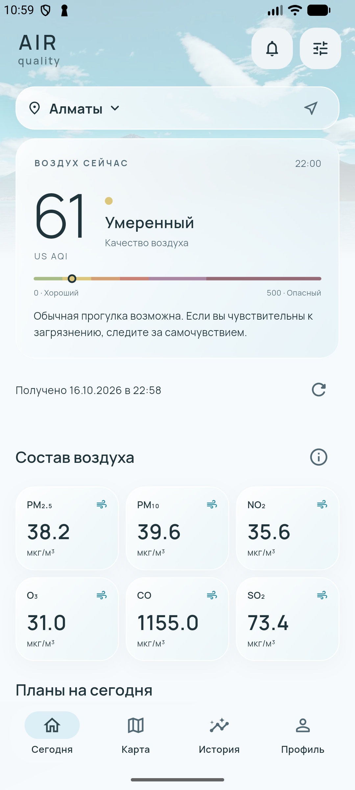
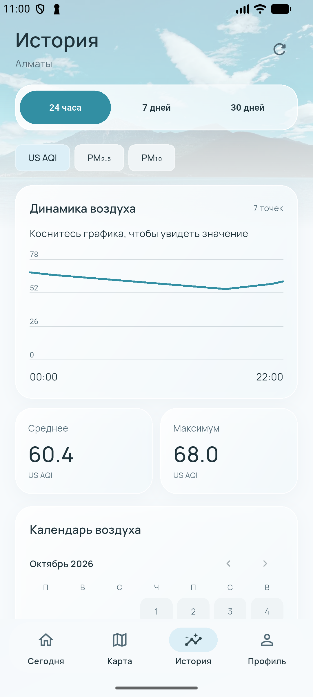
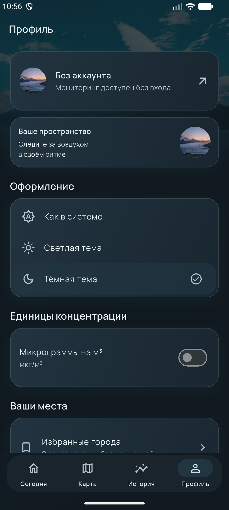

# Air Quality Monitor

> **Комплект РК1, 16.10.2026:** [отчёт по неделям 1–8](RK1_REPORT.md), [проверки](docs/rk1/VALIDATION.md), [сценарий защиты 5 минут](docs/rk1/DEFENSE_5_MIN.md), [что отправить преподавателю](docs/rk1/SUBMISSION.md), [скриншоты](docs/rk1/SCREENSHOTS.md), [эскизы](docs/rk1/wireframes.svg). Firebase недели 8 включён сверх ранее указанной границы РК1 (недели 1–7). [Публичный GitHub](https://github.com/yerkesha-A/air-quality-monitor) опубликован с разрешения владельца; доступ к README и материалам проверен без авторизации.

Нативное мобильное приложение на Dart + Flutter. Сейчас разрабатываем и проверяем **только Android**. iOS отложен по просьбе пользователя. Веб-интерфейс не создавался.

Цель — помочь жителям городов, студентам, родителям и спортсменам понимать качество воздуха, сравнивать места и планировать активность.

<p>
  
  
  
</p>

## Что реализовано

- Первый запуск: «Начать» → вход, регистрация или «Продолжить без аккаунта»; завершение сохраняется.
- Главный экран: текущая оценка US AQI, шесть загрязнителей при наличии, время данных/получения, обновление и pull-to-refresh.
- Прогноз на 24 часа, график с выбором точки, лучший час по минимуму доступного AQI.
- Поиск городов с debounce, избранное, недавние места, сохранение выбора, GPS и reverse geocoding.
- Сравнение двух городов с независимой загрузкой данных и временем получения.
- История сохранённых текущих оценок: 24 часа / 7 / 30 дней, US AQI / PM₂.₅ / PM₁₀, среднее/максимум, календарь доступных дней.
- Рекомендации по AQI и справочник загрязнителей.
- Светлая, тёмная и системная темы; единицы мкг/м³ или мг/м³ для состава воздуха на главной.
- Заметки с текстом и фотографией через Android camera intent; сохранение фото в приватной папке приложения.
- Локальные предупреждения при обновлении свежего AQI выше персонального порога, разрешение Android notifications и история.
- Собственный Android Platform Channel: модель устройства, API level, батарея; кнопка «Об устройстве» в профиле.
- GoRouter: именованные маршруты, StatefulShellRoute, сохранение вкладок, маршрут `/city/:id`, redirect защищённого `/account`, неизвестный маршрут.

Firebase Authentication и Firestore подключены к отдельному проекту Spark `air-quality-monitor-erkezhan`: реальные Android-проверки email/Google-входа, выхода, восстановления сессии и безопасной синхронизации пройдены. Настоящая доставка FCM подтверждена в активном приложении и в фоне. Фото профиля выбирается из галереи/камеры и хранится локально по UID, без Storage. Автоматическая серверная проверка AQI не развёрнута; Google Maps остановлен до решения владельца о billing. Получение нового non-fatal Crashlytics подтверждено серверным API; FCM после завершения процесса и переход по нажатию проверены. [Восстановление Android](docs/ANDROID_RECOVERY_VERIFICATION.md). [Подробная приёмка профиля и Firebase](docs/PROFILE_FIREBASE_VERIFICATION.md).

Полный реестр и подтверждённые проверки: [PROJECT_PROGRESS.md](PROJECT_PROGRESS.md).

## Дизайн

Текущая светлая доработка: [описание, проверки и реальные Android-снимки](docs/SOFT_DESIGN_REVIEW.md).

Небесно-голубой, молочный белый и мягкий teal (#328FA3). Локальные горные фотографии, прозрачные поверхности, Manrope, компактные карточки и четыре вкладки. Фотографии декоративные: они не выдают пейзаж за выбранный город и не иллюстрируют его текущий AQI.

SafeArea, прокрутка, клавиатура, системный back, нижняя навигация и масштабирование текста учитываются в экранах. Widget-проверки охватывают 320 px, телефон 740×360 и планшет 800×1280 / 1280×800, прокрутку экранов и увеличенный текст в обеих темах. Нативная карта с ключом требует отдельной приёмки; защищённый профиль проверен на Android. Ориентиры продукта: IQAir AirVisual (AQI), Windy (карта), Plume Labs (планирование активности).

## Архитектура

```text
lib/core/             тема, router, DI
lib/presentation/     экраны, общие widgets, Provider-контроллеры, BLoC
lib/domain/           сущности, interfaces Repository, рекомендации/use cases
lib/data/             API, generated JSON-модели, SQLite, repositories, native/cloud services
functions/            отдельный Python backend для серверных предупреждений
```

Provider используется для небольших настроек и состояния аккаунта/избранного. BLoC обслуживает Air, CitySearch и History с состояниями Initial / Loading / Success / Empty / Error / Refreshing там, где применимо. Счётчики ревизий защищают от запоздавших ответов. Реализации Repository передаются через конструкторы в `AppDependencies`; production-код не содержит фиктивных значений загрязнения.

`setState` подходит для локального UI (форма, slider, выбранная точка графика), `InheritedWidget` передаёт зависимости по дереву, Provider добавляет удобную подписку и жизненный цикл модели. Отдельный работающий учебный пример всех трёх подходов: [docs/state_examples.dart](docs/state_examples.dart). Проверка без установки: `flutter test test/coursework_test.dart`. Для интерактивного запуска используйте **отдельный учебный AVD**: `flutter run -t docs/state_examples.dart -d <учебный-device-id>`; этот target не устанавливайте поверх основного приложения с данными. Пример не является частью production-потока AQI.

| Подход | Где применяется | Обновление / границы |
| --- | --- | --- |
| setState | Состояние формы, выбор точки графика | Локальный rebuild StatefulWidget; не контейнер общих данных |
| InheritedWidget | Отдельный CounterScope учебного примера | Зависимость через context; updateShouldNotify уведомляет потребителей |
| Provider / ChangeNotifier | Настройки, аккаунт, избранное и DI | watch/read, notifyListeners; модель отделена от UI |
| BLoC | Асинхронные AQI, поиск и история | События → состояния; тестируемая обработка ошибок и stale requests |

Отдельные Dart-задания: [coursework/week01](coursework/week01/README.md). Краткий исходный пример сохранён в docs/dart_basics.dart. Расширение заданий и ретроспективные [эскизы](docs/rk1/wireframes.svg) подготовлены 16.10.2026, без заявления о прошлой сдаче.

## Источник и смысл данных

[Open-Meteo Air Quality API](https://open-meteo.com/en/docs/air-quality-api) предоставляет **оценки атмосферной модели Copernicus CAMS**, а не показания ближайшей физической станции. Запрашиваются `us_aqi`, `pm2_5`, `pm10`, `nitrogen_dioxide`, `ozone`, `carbon_monoxide`, `sulphur_dioxide`. Все концентрации исходно в мкг/м³. Используются Unix timestamps; часовые подписи учитывают UTC offset выбранного места.

Шкала только US AQI: 0–50 / 51–100 / 101–150 / 151–200 / 201–300 / 301+. [Категории EPA / AirNow](https://www.airnow.gov/aqi/aqi-basics/). Рекомендации ознакомительные, без медицинской диагностики. Поиск и разрешение ID города — [Geocoding API / GeoNames](https://open-meteo.com/en/docs/geocoding-api). Бесплатный API предназначен для некоммерческого использования; перед коммерческой публикацией необходимо проверить актуальный тариф/условия.

API-клиент проверяет HTTP, JSON, поля, нечисловые/отрицательные значения и таймаут 18 секунд. Нет выдуманных значений для отсутствующих загрязнителей.

## Локальные данные и офлайн

SharedPreferences: тема, единицы, пороги/разрешённые сценарии уведомлений, onboarding, выбранное место. SQLite: кеш ответов, избранное/недавние места, текущие оценки по часовым слотам, заметки, история предупреждений. Схема содержит миграции 1 → 2 → 3; версия 3 добавляет индексы для постраничных выборок, сохраняя существующие записи.

При загрузке сначала показывается кеш, затем сетевой результат. При сбое обновления сохраняются исходные время получения и время модели; интерфейс показывает «Сохранённые данные» и настоящую причину ошибки. HTTP 429/500, неверный JSON или таймаут не выдаются за доказанное отсутствие интернета. Данные требуют обновления, если получены более часа назад, время текущей оценки модели старше двух часов или более чем на час в будущем; время получения более чем на 5 минут в будущем также считается ненадёжным. Для сравнений используется UTC. Эти пределы — защитная политика приложения, не обещание обновления модели каждые два часа. История записывает **только текущую оценку при запросе**, не прогноз. Она накапливается с использованием приложения, ограничена примерно 31 днём и не представляет непрерывные станционные измерения. Среднее считается по доступным точкам. На новом устройстве 30-дневного архива нет.

Заметки, история уведомлений и подробные записи истории читаются из SQLite страницами по 20 строк с одной строкой для проверки продолжения. Используется keyset-cursor: `(created, id)` или `time`, а не постоянно растущий LIMIT. Есть переходы вперёд/назад и повтор после ошибки. График, календарь и статистика истории продолжают использовать весь доступный период до 31 дня; страница не меняет среднее. Поиск городов возвращает до 15 вариантов самого Geocoding API и не имитирует неподдерживаемую серверную пагинацию.

Данные запрашиваются при запуске с выбранным городом, выборе места/GPS и ручном обновлении; карта и сравнение выполняют собственные запросы. Фонового таймера загрузки AQI нет. Прогноз ограничен будущими 24 часами, отсутствующие значения не генерируются.

## Запуск Android

Flutter 3.47.5 / Dart 3.13.4. Android SDK и лицензии проверены. Установлены Java из Android Studio, AGP 9.1.0 и Gradle 9.3.1. Минимальная версия приложения — Android API 24.

```sh
flutter pub get
flutter run -d emulator-5554
flutter build apk --debug
```

APK: `build/app/outputs/flutter-apk/app-debug.apk`. Это debug-сборка для тестирования, не подписанный production-релиз. Gradle wrapper сразу использует `https://services.gradle.org/distributions/gradle-9.3.1-all.zip`; локальных абсолютных путей в wrapper нет. После клонирования установите Flutter/Android SDK и JDK (в CI — 21), примите Android-лицензии и выполните команды выше. `android/local.properties` создаётся Flutter для SDK этой машины, в Git не хранится. Первая сборка требует доступа к серверам Gradle, Google Maven и pub.dev. `tools/portable_gradle.py` оставлен как совместимый нормализатор старых checkout, для текущего wrapper не требуется.

Подробная инструкция с настоящими debug SHA fingerprints: [docs/ANDROID_FIREBASE_SETUP.md](docs/ANDROID_FIREBASE_SETUP.md).

## Firebase: текущая конфигурация Android

Используется существующий `air-quality-monitor-erkezhan`, Android package `com.example.air_quality_monitor`.
Email/Password, Google OAuth и Firestore уже настроены; не создавайте дубликат.
`android/app/google-services.json` скачан и исключён из Git. После клонирования
конфигурацию нужно получить у владельца; signing keys и service account credentials не публикуются.
Нативная инициализация использует ресурсы Google Services Gradle plugin.

Перед upload CloudSync читает данные через `Source.server`, восстанавливает настройки
и объединяет избранное. Ошибка чтения блокирует upload. Пустой локальный список не
удаляет облачные документы; удаляются только явные действия пользователя с очередью по UID.
Реальное облачное восстановление проверено, физическое второе устройство — ещё нет.
Локальное фото профиля не записывается в Firestore; Google photo URL сохраняется отдельно.
[Состояние Firebase и проверки](docs/STAGE2_FIREBASE_ANDROID.md).

## Google Maps

Проверено 16 октября 2026: `billingEnabled: false`, Maps SDK for Android `DISABLED`, локальный API key отсутствует. [Google требует billing для SDK](https://developers.google.com/maps/documentation/android-sdk/usage-and-billing). Подключение остановлено по требованию владельца: billing/API/ключи не создавались и не включались. Другая карта без согласования не подставляется. После отдельного разрешения понадобится Android API key с ограничениями package + SHA-1 и только Maps SDK for Android; ключ передаётся локально, не публикуется.

Карта — `google_maps_flutter` / настоящий Android SDK, без статической подмены. Код поддерживает выбор точки, маркеры текущего/сохранённых мест, проверку центра после перемещения и GPS. Ключ и tiles/gestures пока не проверены: сервиса ещё нет. [Документация пакета](https://pub.dev/packages/google_maps_flutter).

## Уведомления и сервер

Локальные предупреждения проверяются при получении свежего AQI в открытом приложении, с дедупликацией места/часа/порога. Они не обещают фоновую периодическую работу. FCM-код включает foreground/background reception, токены устройства, историю получения и открытие Alerts по нажатию.

`functions/main.py` — отдельный сервер на Python для Cloud Functions + Cloud Scheduler. Он получает настоящий US AQI, проверяет порог и актуальность модели, использует Firestore transaction для дедупликации и отправляет FCM только зарегистрированным устройствам соответствующего пользователя. Успешная отправка в FCM не доказывает доставку на телефон. Код не развёрнут; тесты Python сейчас проверяют только чистую логику порогов/координат/ID, а не весь облачный job.

FCM foreground/background и tap routing проверены настоящей отправкой HTTP v1. Получение push доступно независимо от scheduler; при входе/восстановлении настроек обновляется регистрация устройства, после выхода токен не привязывается к пользователю. `AQI_SCHEDULER_DEPLOYED` оставлен false: автоматические AQI-предупреждения требуют отдельного согласованного backend-развёртывания. Переустановка приложения не выполняется для тестирования, чтобы сохранить данные владельца. [Cloud Scheduler](https://firebase.google.com/docs/functions/schedule-functions) и [FCM reception](https://firebase.google.com/docs/cloud-messaging/flutter/receive-messages).

## Тестирование

```sh
flutter analyze
flutter test --coverage
python3 tools/check_coverage.py
flutter test integration_test/mobile_smoke_test.dart -d emulator-5554 --no-uninstall
flutter test integration_test/air_flow_test.dart -d emulator-5554 --no-uninstall
python3 -m unittest discover -s functions -p 'test_*.py'
npm ci --prefix tools/firebase-tests
node tools/firebase-tests/node_modules/firebase-tools/lib/bin/firebase.js emulators:exec --only firestore --project demo-air-quality-monitor 'node --test tools/firebase-tests/rules.test.mjs'
```

**Важно для текущего Flutter SDK:** integration runner по умолчанию удаляет приложение после тестов. На AVD с нужными локальными данными всегда используйте `--no-uninstall` и предварительную резервную копию Android app data; источник кода не содержит SQLite/фото устройства.

Для Firebase Emulator нужна Java 21+; можно использовать JBR Android Studio через JAVA_HOME. Node используется **только инструментами и тестами правил**, Android UI написан на Dart/Flutter. Demo project не обращается к настоящему облачному Firebase.

Актуальные результаты: [профиль и Firebase](docs/PROFILE_FIREBASE_VERIFICATION.md); история этапа 1: [docs/STAGE1_PREPARATION.md](docs/STAGE1_PREPARATION.md).

Сейчас на AVD сохранена Google-сессия владельца. Для неё используйте `integration_test/profile_session_test.dart` с `--no-uninstall`: сначала capture (без define), затем после остановки процесса verify (`--dart-define=VERIFY_PROFILE_RESTART=true`). Onboarding-тесты рассчитаны на гостевую сессию; Firebase registration/push tests — на отдельный тестовый аккаунт. Не выходите из аккаунта владельца и не очищайте его данные ради общего запуска этих тестов. Покрытие считается по свежему `coverage/lcov.info` после полного `flutter test --coverage`; не следует использовать числа предыдущих редизайнов. Синтетические fixtures и транспортные моки применяются только в тестах, production AQI берётся из Open-Meteo.

Ранее на эмуляторе проверялись GPS, camera capture/save, уведомление в шторке и cold start без сети. Эти проверки не заменяют приёмку на физическом смартфоне и реальную FCM-доставку. Firestore Rules и Python имеют отдельные локальные тесты; новый облачный проект для них не нужен.

GitHub Actions запускает зависимости, форматирование, analyze, test/coverage >40%, Android debug build, Python logic и Firestore Rules. Workflow опубликован; [GitHub Actions](https://github.com/yerkesha-A/air-quality-monitor/actions) запускается при push. Локальные результаты приведены в VALIDATION; состояние удалённых запусков проверяйте по ссылке Actions.

## Релиз и ограничения

Release APK/AAB требует настоящего keystore и `android/key.properties`; образец — `android/key.properties.example`. Debug-подпись для release больше не подставляется. Crashlytics-код и Gradle plugin подготовлены, сбор диагностик включается в release при настоящем Firebase; non-fatal отчёт подтверждён серверным API. Подписанные APK/AAB собраны существующим ключом; исправлен release resource shrinking для иконки уведомлений и Firebase/OAuth-строк. Google Sign-In в release и сохранение сессии после полного перезапуска проверены. [Актуальная проверка](docs/ANDROID_RECOVERY_VERIFICATION.md). Публикация в Google Play не выполнялась.

Остаются решение владельца о billing Google Maps, смена пароля по полученной ссылке и вход с новым паролем, синхронизация на двух устройствах, камера/GPS на физическом устройстве, английская локализация, сравнение исторических периодов, экспорт визуальной карточки (пока share текста отчёта), полный DevTools-профиль, публичная privacy policy. Автоматическая ежедневная push-сводка не реализована; на главной есть рекомендации и лучший час по текущим данным/прогнозу. Фото не определяют качество воздуха. iOS не настраивается до завершения Android.

## Реальные Android-скриншоты

Текущий светлый дизайн: [главная](docs/screenshots/android-soft-home.png), [история](docs/screenshots/android-soft-history.png), [профиль](docs/screenshots/android-soft-profile.png), [вход](docs/screenshots/android-soft-login.png), [регистрация](docs/screenshots/android-soft-register.png), [выбор города](docs/screenshots/android-soft-city.png). Снимки сняты с Android Emulator.

Главная, история и профиль используют верхнюю фотографию неба/гор с плавным переходом в молочный фон. На остальных экранах спокойные поверхности; у авторизации и первого запуска есть атмосферная фотография. Полноэкранного лесного фона и принудительной тёмной темы истории в текущей версии нет. Фотографии оптимизированы в WebP, локальные шрифты Manrope/Lora. [Источники изображений и лицензии](assets/images/CREDITS.md). [Актуальная дизайн-приёмка](docs/SOFT_DESIGN_REVIEW.md). Документ DESIGN_REVIEW хранит историю предыдущих вариантов.
